# screws

Screw-theory robotics in Python, after Lynch and Park, *Modern Robotics* (MR).
`screws` is the MR code library reorganised: the same mathematics under
snake_case names, MR's own names kept as aliases, a `Robot` class, a URDF
loader, robots that ship ready to use, and a bridge to CoppeliaSim.

## Install

One or the other:

```
uv add screws                 # the mathematics only; numpy is the sole dependency
uv add "screws[coppelia]"     # the same, plus the CoppeliaSim ZMQ remote API client
```

Extras for the bridge: `screws[plot]` (matplotlib, for `Log.plot`) and `screws[video]`
(imageio and ffmpeg, for `Recorder`). `uv add "screws[coppelia,plot,video]"` takes all three.
`screws[symbolic]` adds SymPy, for the formulas of `screws.symbolic`.

## Four lines

```python
import screws

ur5 = screws.robots.ur5()                          # M, screw axes, inertias from the textbook's URDF
T = ur5.fk([0.3, -1.2, 0.8, -0.4, 1.1, 0.2])         # a reachable, non-singular pose
result = ur5.ik(T, theta0=[0.1, -1.4, 0.1, 0.1, 1.4, 0.1])   # result.theta, result.converged, result.history
```

The free functions are the reference implementation and read as the book does:
`screws.exp6(screws.vec_to_se3(S * theta))` is $e^{[\mathcal{S}]\theta}$,
`screws.fk_space(M, S, theta)` is the space form of the product of exponentials, and
`screws.FKinSpace` is the very same function under MR's name.

Screw-axis lists are **6xn, one axis per column**, as MR writes them. Nothing guesses the
orientation (a 6x6 array is ambiguous for a six-axis arm), so hand entry goes through a
sequence of 6-vectors: `screws.Robot.from_screw_axes(M, [S1, S2, ...])`.

## Check your own code against the library

```python
import numpy as np
import screws

def my_exp6(se3mat): ...                          # your implementation

rng = np.random.default_rng(0)
cases = [screws.vec_to_se3(rng.normal(size=6)) for _ in range(20)]
screws.testing.check(my_exp6, screws.exp6, cases)  # raises on the first disagreement
```

## Dynamics and trajectories

```python
import numpy as np
import screws

ur5 = screws.robots.ur5()                          # link frames and inertias from the URDF
theta = np.zeros(6)
tau_g = ur5.gravity_forces(theta)                  # joint torques that hold the arm still
M = ur5.mass_matrix(theta)                         # 6x6, symmetric positive definite
tau = ur5.inverse_dynamics(theta, np.zeros(6), np.ones(6) * 0.1)   # + optional F_tip
ddtheta = ur5.forward_dynamics(theta, np.zeros(6), tau)
theta_ref = screws.joint_trajectory(theta, theta + 0.5, T_final=2.0, N=41)   # 41 rows, quintic
```

`inverse_dynamics`, `mass_matrix`, `velocity_quadratic_forces`, `gravity_forces`,
`end_effector_forces`, `forward_dynamics`, `euler_step` and the two `*_trajectory` functions
are MR chapter 8 as free functions too, with the robot's `link_frames`, `link_inertias` and
`S` passed in. `joint_trajectory`, `screw_trajectory` and `cartesian_trajectory` take
`scaling="quintic"` (default) or `"cubic"`. A `Robot` without inertias raises
`MissingInertias` from every dynamics method.

## Formulas: `screws.symbolic`

The same functions in SymPy, so the product of exponentials, the Jacobians and the
dynamics come out as formulas in the joint variables (`uv add "screws[symbolic]"`):

```python
import sympy as sp
import screws
import screws.symbolic as sym

L1, L2 = sp.symbols("L1 L2", positive=True)
arm = sym.SymbolicRobot.from_screw_axes(
    sym.trans([L1 + L2, 0, 0]),
    [sym.revolute_axis([0, 0, 0], [0, 0, 1]), sym.revolute_axis([L1, 0, 0], [0, 0, 1])],
)
arm.fk()              # p = (L1 cos(theta1) + L2 cos(theta1 + theta2), L1 sin(theta1) + L2 sin(theta1 + theta2), 0)
arm.jacobian_body()   # first column (0, 0, 1, L1 sin(theta2), L1 cos(theta2) + L2, 0)

ur5 = screws.robots.ur5("textbook").symbolic()             # 0.425 is read as 17/40
T = ur5.fk()                                                 # T_sb(theta1, ..., theta6), simplified
Js = sp.lambdify(ur5.theta, ur5.jacobian_space(), "numpy")   # back to numbers, fast
```

Every function keeps the name and the arguments of its numerical twin (`sym.fk_space(M, S,
theta)`, `sym.jacobian_body(B, theta)`, `sym.exp6(se3mat)`, `sym.adjoint(T)`, MR's names
too: `sym.FKinSpace is sym.fk_space`) and returns SymPy matrices, vectors as columns. Leave
out theta and the joint variables are the symbols `theta1 ... thetan` (`ur5.theta`;
`thetadot1 ...` and `thetaddot1 ...` in the dynamics). `simplify=False` skips the
simplification, which is most of the time on a six-joint arm.

`robot.symbolic()` reads a robot's floats exactly: a float becomes the decimal it prints as,
or the fraction, multiple of pi or surd it is to the last bit (`np.pi / 2` is `pi/2`). A URDF
that rounds pi/2 leaves a few millionths where zeros were meant, and read exactly they never
cancel, so `symbolic()` warns; `decimals=` rounds first. With
`screws.robots.ur5().symbolic(decimals=6)`, `gravity_forces()` is the UR5's g(theta), three
short nonzero entries, in about twenty seconds (`sympy.N(g, 4)` shows it in decimals).
`simplify=` also takes a function to use instead, such as `sympy.trigsimp`.

The dynamics give MR 8.1's two-link equations of motion from the Newton-Euler recursion:

```python
m1, m2, g = sp.symbols("m1 m2 g", positive=True)
point_mass = [sp.diag(0, 0, 0, m, m, m) for m in (m1, m2)]
arm = arm.with_gravity([0, -g, 0]).with_inertias(
    [sym.trans([L1, 0, 0]), sym.trans([L2, 0, 0]), sp.eye(4)], point_mass
)
arm.mass_matrix()                  # [[L1**2*m1 + ... + 2*L1*L2*m2*cos(theta2) + ..., ...], ...]
arm.velocity_quadratic_forces()    # c(theta, thetadot)
arm.gravity_forces()               # g(theta)
arm.forward_dynamics()             # thetaddot in terms of tau1, tau2
```

Not symbolic, being numerical by nature: the logarithms, inverse kinematics, manipulability,
time stepping and trajectories.

## CoppeliaSim

Works with CoppeliaSim 4.9 or later through the ZMQ remote API (0.1 verified on 4.10.0).

```python
from screws.coppelia import Scene

with Scene() as scene:                 # connects to localhost:23000 in stepping mode
    arm = scene.arm("/UR5")            # the joints under that tree, base to tip
    robot = arm.robot()                # a screws.Robot read off the scene at zero
    arm.mode("position")
    log = scene.run(lambda t, theta, dtheta: theta_desired(t), duration=5.0, arm=arm)
log.plot()                             # four stacked time plots: theta, dtheta, tau, command
log.to_csv("run.csv")
```

**Record a movie.** One frame per simulation step, so the movie plays at simulated time
however slowly the controller ran:

```python
with Scene() as scene:
    arm = scene.arm("/UR5")
    arm.mode("position")
    with scene.record_video("run.mp4", position=(1.5, -1.5, 1.0), look_at=(0, 0, 0.4)):
        scene.run(controller, duration=5.0, arm=arm)
```

`record_video` creates a camera (or reuses one: `camera="/Camera"`), grabs its image before
every step (`every=2` halves the frame rate), and on exit writes `.mp4` or `.gif`.

**In a notebook, release the clock between cells.** In stepping mode CoppeliaSim waits for
the next `step()`, and while it waits its window stops redrawing; after a few seconds it shows
a "ZMQ remote API server ... abort execution" banner, and clicking that kills the remote API
and strands the notebook. End a cell that stepped with `scene.release()`: the simulation then
runs on its own (position targets hold the arm still) and the window stays live. The next
`scene.step()` takes the clock back.

**Read the scene's masses.** `arm.robot(inertias=True)` reads every dynamic shape's mass and
inertia and builds the MR link frames and spatial inertias, so a model-based controller can
be run against the simulator's own numbers, and against the textbook's URDF numbers, and the
difference explained. `relative_to="base"` makes {s} the model's base frame.

`Scene` owns the connection and the clock (`start`, `step`, `release`, `stop`, `time`, `dt`,
`frame`, `show_frame`). `Scene.run` records every step into a `Log` (`t`, `theta`, `dtheta`,
`tau`, `command`, `T_sb` as arrays); `Log.plot()` draws one time-series axis per joint quantity
and shows the figure, `Log.to_csv` writes it out. `Arm` reads (`theta`, `dtheta`, `tau`, `tip_frame`) and commands
in one of three modes (`position`, `velocity`, `torque`), or `teleport`s without physics
to animate an IK history. `Arm.robot()` derives M and the screw axes from the scene's
joint frames (omega is the joint's z axis, v = -omega x q).

## Pictures of the screw axes

```python
import screws
from screws import viz

ur5 = screws.robots.ur5()
theta = [0.3, -1.1, 1.4, 0.2, 0.9, -0.5]
viz.draw_robot(ur5)                                   # skeleton, {s}, and S_1 ... S_6 at home
viz.draw_robot(ur5, frame="body")                     # the same robot seen from {b}: B_1 ... B_6
viz.draw_robot(ur5, theta, axes="current")            # the axes where theta has carried them: J_s(theta)
viz.draw_robot(ur5, joints=[2], show=("skeleton", "frames", "axes", "omega", "construction"))
viz.draw_screw(screws.screw_axis(q=[0.3, 0, 0], s_hat=[0, 0, 1], h=0.05))   # one axis by itself
viz.explore(ur5)                                      # joint sliders, in a notebook
```

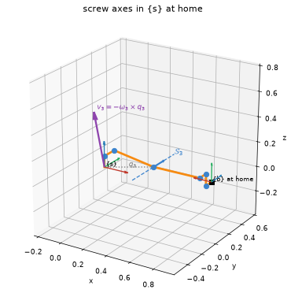

`draw_robot` draws the robot's skeleton at `theta` (default: home), the reference frame,
and one screw axis per joint through the joint's home position with its ω̂ arrow. With
`"construction"` it also draws, for each chosen joint, the point q on the axis, the cross
product −ω̂×q, the pitch term hω̂, and their sum v at the origin, so the formula
v = −ω̂×q + hω̂ is something you can look at. The body-frame view redraws everything in {b},
which is why the B_i differ from the S_i. Every drawing returns the vectors it drew, so a
figure can be checked by hand. Needs `screws[plot]`.

**Where the axes are now.** The default, `axes="home"`, draws the axes at home even when the
arm is posed at θ: they are the S_i of the product of exponentials. `axes="current"` draws
each axis where the joints inboard of it have carried it, which is column i of J_s(θ) (of
J_b(θ) with `frame="body"`), labelled J_si. With `"construction"` the same drawing builds that
column, J_si = (ω_i, −ω_i × q_i) for a revolute joint through q_i, as MR 5.1.1 builds J_s:

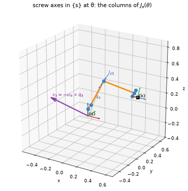

```python
viz.draw_robot(ur5, theta, axes="current", joints=[2], show=("skeleton", "frames", "axes", "omega", "construction"))
```

`viz.draw_jacobian` is this drawing with the velocities the joints give the tool, and the
matrix beside it; see [Jacobians and manipulability ellipsoids](#jacobians-and-manipulability-ellipsoids).

**Colours.** Every picture the package draws uses one colour per meaning, never one per
joint. Red, green and blue are a frame's x̂, ŷ and ẑ and nothing else. Links are orange and
joints blue, as in the notes, and a screw axis, with its ω̂, is the joints' blue. Purple is
velocity: v (its pieces −ω̂×q and hω̂ a lighter purple), the velocities of points in a screw
motion, the velocities the joints give the tool, and the manipulability ellipsoid that collects
them. Grey is a position or a path, and the force ellipsoid is grey and dashed. Labels tell
the joints apart.

## Watching a screw motion

```python
from screws import viz

viz.animate_screw(viz.door())          # the door swung about its hinge, with T(θ) = e^[S]θ T(0) beside it
viz.animate_twist(viz.screwdriver())   # the screwdriver under a constant twist: a helix about -z
viz.compare_frames(viz.door())         # V_s beside V_b, and V_s = [Ad_Tsb] V_b underneath
viz.animate_screw(viz.screw_between(T_start, T_end))   # the one screw motion from one frame to another
viz.animate_twist([0, 0, 1, 0, -0.5, 0.1], duration=4).save("mine.gif")   # any twist, any body
```

A twist is a motion before it is a six-vector. `animate_twist` plays a constant twist on a
body: the screw axis drawn as a line with ŝ and the pitch h, one point's path traced (a
helix, or a circle at zero pitch), and purple arrows for the velocities ω × p + v of a few
points. `animate_screw` sweeps a screw axis over θ and prints the line read off it,
q = ω × v and h = ωᵀv, with T(θ) changing alongside.

**Three pitches.** The scenes `viz.door()`, `viz.drawer()` and `viz.screwdriver()` are the
three motions of the notes' chapter 3 review: zero, infinite and finite pitch.

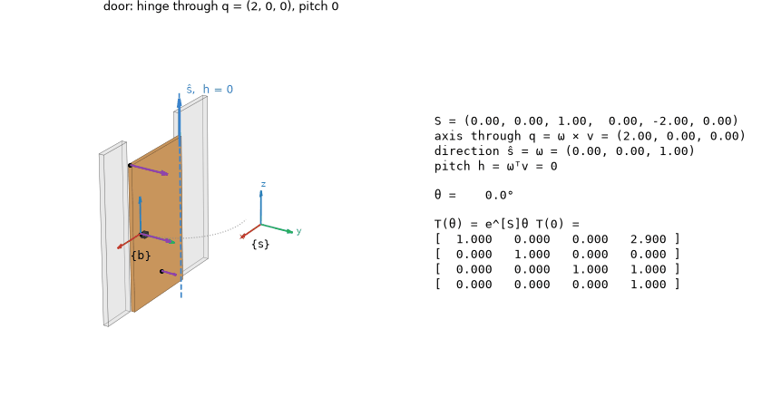

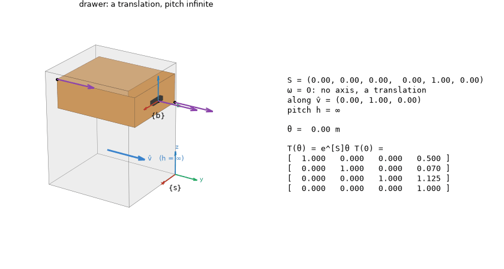

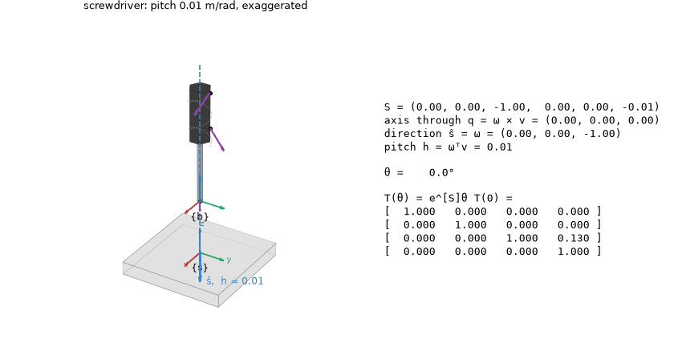

**Space and body twists.** `compare_frames` draws one motion twice. On the left, v_s is the
velocity of the body point at the {s} origin: the grey marker is the point that was there
at θ = 0, carried off by the motion while the point now at the origin keeps the same
velocity. On the right, v_b is the velocity of the point at {b}. Under them,
V_s = [Ad_Tsb(θ)] V_b, the adjoint changing and V_s fixed.

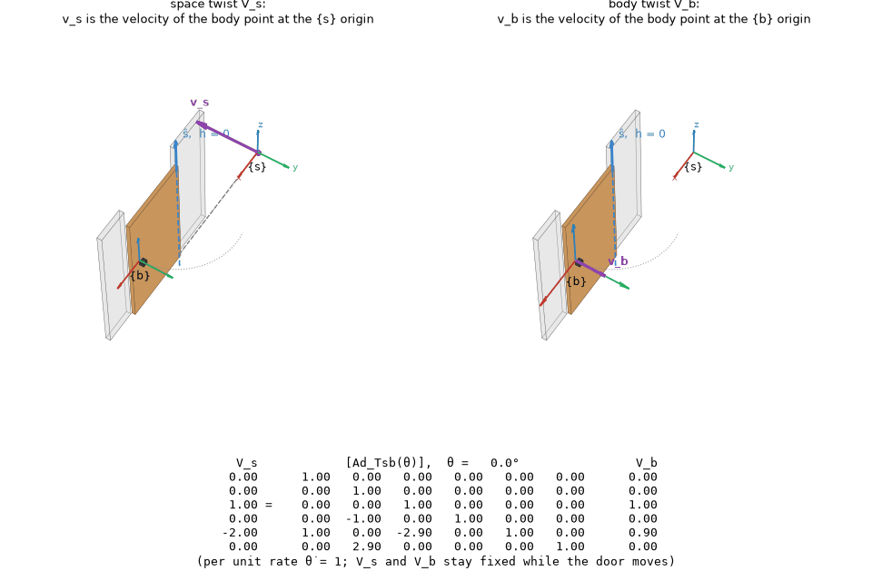

`animate_twist` plays the same door in time, V_s = S θ̇:

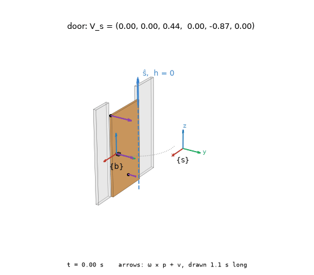

**From one frame to another.** Every rigid-body displacement is a screw motion (Chasles).
`viz.screw_between(T_start, T_end)` finds the one that carries `T_start` to `T_end`, from
[S]θ = log(T_end T_start⁻¹) with S a unit screw axis, and `animate_screw` shows the frame
travelling along it, its origin tracing the helix, the start and end frames faded:

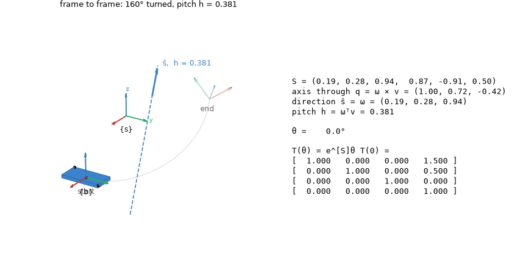

Each call returns an `Animation`: `.save("x.gif")` (or `.mp4` with `screws[video]`), it plays
inline in a notebook, and `.data` holds the numbers drawn. `viz.Scene`, `viz.box` and
`viz.prism` build your own body. The geometry is `screws.screw_line`, `screw_motion`,
`point_velocity` and `helix`, numpy only. `examples/screw_motions.py` writes every GIF here.

## Jacobians and manipulability ellipsoids

Every picture in this section was drawn by the package itself, from the call shown under it
(`examples/jacobians.py` writes them all). The robots are the UR5 and the notes' 2R arm, and
the numbers in the titles are the ones notes 5.5 works by hand.

```python
import numpy as np
from screws import robots, viz

ur5, arm = robots.ur5(), robots.planar_2r()        # planar_2r: the notes' 2R arm, L1 = L2 = 1
theta = [0.3, -1.1, 1.4, 0.2, 0.9, -0.5]
theta0 = [0, -1.2, 1.5, -1.6, -1.57, 0]
```

**Each column as what it is.** Column i of J_s(θ) is joint i's screw axis *now*, S_i carried
there by the joints inboard of it: the axis `draw_robot(ur5, theta, axes="current")` draws.
At home it is the S_i (J_s(0) = [S_1 ⋯ S_n]). The colours are the package's, above.

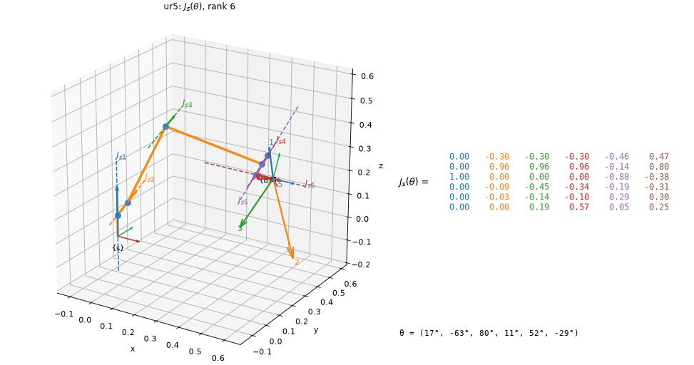

```python
viz.draw_jacobian(ur5, theta)
```

The dashed lines are the six columns of J_s, labelled J_s1 to J_s6. The numbered arrows at the
tool are the tool point's velocity, R_sb J_bv, per unit rate of each joint alone. The title
gives the rank and says when the configuration is singular. `frame="body"` redraws the same
lines from {b} and prints J_b.

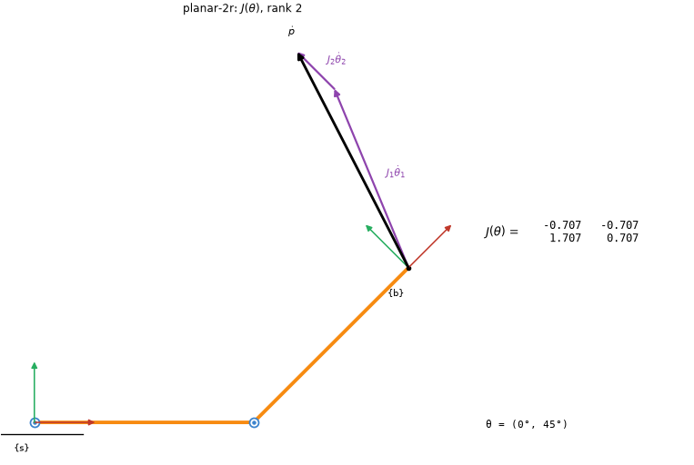

```python
viz.draw_jacobian(arm, [0, np.pi / 4], dtheta=[1, 0.5], planar=True)
```

Every robot is drawn in 3D, a planar one included, unless `planar=True` asks for it flat, as
the notes draw the 2R arm. Its matrix is then the notes' 2 × 2 J(θ), here
[[−0.707, −0.707], [1.707, 0.707]]. Given θ̇ = (1, 0.5), the columns J_i θ̇_i go head to tail,
and their sum is ṗ.

**Manipulability and force, at the tool.** The purple ellipse is the image of the unit sphere
of joint rates: semi-axes √λ_i along the eigenvectors of A = JJᵀ. Dashed grey is the force
ellipsoid, on the same axes with semi-axes 1/√λ_i. μ1, μ2 and μ3 go in the title.

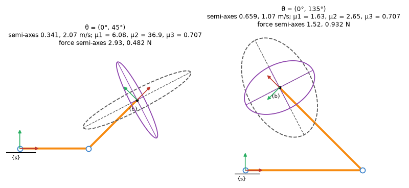

```python
viz.draw_ellipsoid(arm, [0, t2], force=True, planar=True, scale=0.3, force_scale=0.3, ax=ax)
```

The two postures of notes 5.5, drawn at one scale. Both have μ3 = 0.707, but μ1 is 6.08
against 1.63, which is the point that example makes. Left to itself, each ellipsoid gets its
own scale, its longest semi-axis 0.3 of the robot's reach.

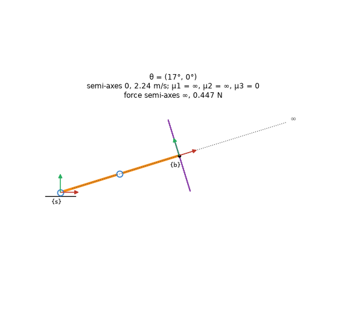

```python
viz.draw_ellipsoid(arm, [0.3, 0], force=True, planar=True)
```

Stretched out, at θ2 = 0. The velocity ellipse is a segment, with semi-axes 0 and 2.24 m/s.
Along the arm the force ellipse is unbounded, so the picture draws only its bounded section,
dots the lost axis and marks it ∞. It never draws a big finite ellipse.

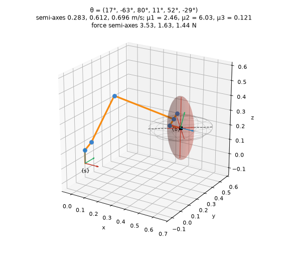

```python
viz.draw_ellipsoid(ur5, theta, force=True)
```

In 3D the linear ellipsoid comes from J_b's linear rows, as MR advises, turned into {s} so it
sits on the tool. The semi-axes are 0.283, 0.612 and 0.696 m/s, and μ1 = 2.46. The force
ellipsoid has its own scale.

**Through a change of configuration.** `animate_robot` moves the robot at a constant rate, and
the axes, the ellipsoid and (with `matrix=True`) the matrix follow it. The chart underneath
tracks the semi-axes, so a singularity shows up as one of them falling to zero.

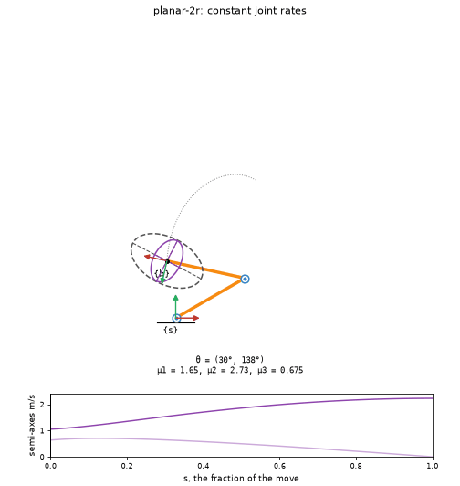

```python
viz.animate_robot(arm, [np.pi / 6, 2.4], [np.pi / 3, 0], force=True, planar=True)
```

Constant joint rates into the stretched-out singularity. The short semi-axis reaches zero in
the last frame.

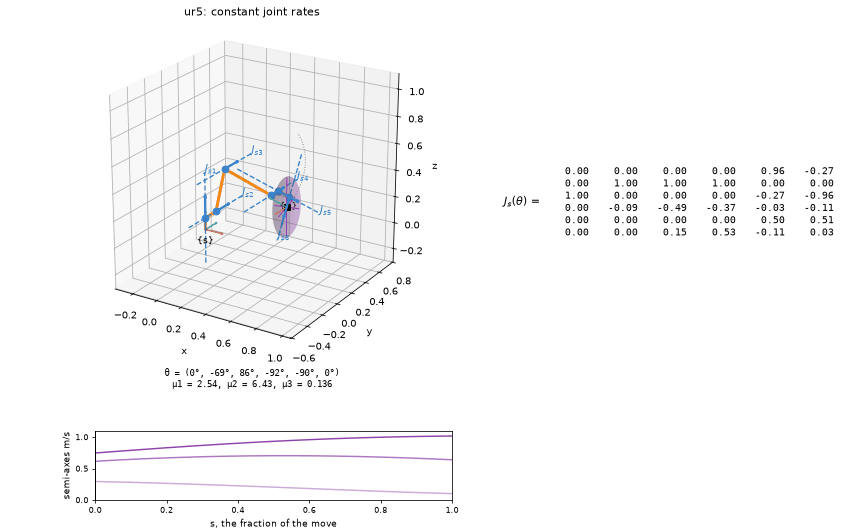

```python
viz.animate_robot(ur5, theta0, [0.4, -0.9, 0, -1.3, -1.57, 0.4], matrix=True)
```

The UR5 straightens its elbow, θ3 going to 0. By the end rank J_s = 5, but the tool point's
ellipsoid is still full, because the wrist can still move the tool point in every direction.
That is why the caption names the matrix that lost rank.

The default is constant joint rates, a straight line in joint space. `path="screw"` moves the
tool at a constant twist instead, the screw motion between the two tool frames, with the
joints following by inverse kinematics. Any (N, n) path plays as given: a `joint_trajectory`,
or an `IKResult.history` to watch Newton–Raphson converge. `.data` holds J_s, J_b, θ̇, V_s,
V_b and the semi-axes for every frame.

**Two kinds of constant rate.** Both panels start and end in the same place. Each charts the
quantity that changes along the way and states the one held fixed.

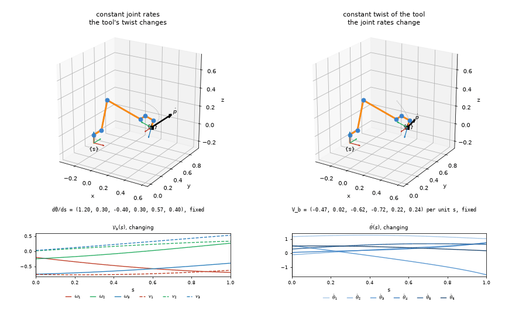

```python
viz.compare_paths(ur5, theta0, [1.2, -0.9, 1.1, -1.3, -1.0, 0.4])
```

On the left the joint rates are constant, so the tool's twist V_b changes and the tool does
not follow a screw. On the right the tool follows one screw motion at a constant twist, and
inverse kinematics finds the joint rates that change to make it happen. In the twist's chart
each component takes its axis's colour, ω solid and v dashed.

**The numbers behind the pictures.** The ellipsoids come from core `screws`, which needs no
matplotlib. These match the notes' chapter 5 UR5 ellipsoid program to every printed digit:

```python
>>> np.set_printoptions(precision=4)
>>> e = robots.ur5("textbook").manipulability_ellipsoid(np.full(6, np.pi / 2))
>>> e.eigenvalues            # λ of A = J Jᵀ, J = R_sb J_bv
array([0.0578, 0.1109, 0.2547])
>>> e.radii                  # √λ, m/s per unit joint rate
array([0.2404, 0.333 , 0.5046])
>>> np.round(e.measures, 4)  # μ1, μ2, μ3
array([2.0995, 4.408 , 0.0404])
>>> robots.ur5("textbook").force_ellipsoid(np.full(6, np.pi / 2)).radii
array([4.1604, 3.0027, 1.9816])
```

| Call | Gives |
| --- | --- |
| `screws.manipulability_ellipsoid(J)` | An `Ellipsoid` for any block of a Jacobian: `center`, `axes`, `eigenvalues`, `radii`, `measures`, `outline()`, `surface()` |
| `screws.force_ellipsoid(J)` | The same axes with reciprocal semi-axes, ∞ where J has lost rank |
| `robot.manipulability_ellipsoid(theta, kind)` | The tool's ellipsoid in {s}, `"linear"` (from J_b) or `"angular"` (from J_s); `planar=True` gives a planar arm's ellipse in the plane |
| `robot.force_ellipsoid(theta, kind)` | The same for forces (moments for `"angular"`) |
| `viz.explore(robot, draw=viz.draw_ellipsoid)` | Joint sliders in a notebook that redraw `draw_robot`, `draw_jacobian` or `draw_ellipsoid` |

## An example: putting

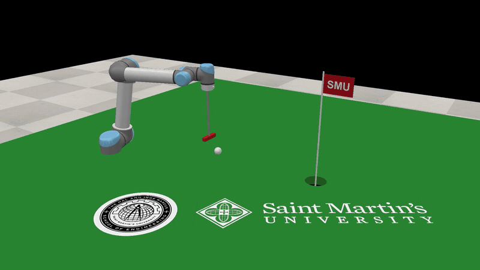

[Full-resolution movie (mp4)](docs/media/putt.mp4), recorded by the example itself with `screws.coppelia.Recorder`.

`examples/putt.py` builds a green in a running CoppeliaSim (turf with a real cup cut through
it, a pin and flag, a ball, and a putter on the UR5's flange), drives the arm in kinematic
mode, addresses the ball, swings the putter through it like a pendulum at a chosen face
speed, returns to the address pose, and reports whether the ball dropped. It records the
putt at 1080p and, given PNGs, lays a seal and a logo on the green and texts the flag:

```
uv run python examples/putt.py --video putt.mp4 --flag-text SMU --seal seal.png --logo logo.png
```

The pieces are in `screws.coppelia.golf`: `build_green`, `attach_putter` (whose `.robot()`
moves `M` from the flange to the putter face), `address_pose`, `swing_path`, `putt`, and the
image helpers `text_image`, `seal_image` and `logo_image`. Vary the speed, the hole position
or the ball's friction and see what the physics does. Two lessons the example encodes: the
stock model's demo script is removed when the bridge takes the arm (it would fight you), and
a tool that must strike repeatably runs the arm in `arm.mode("kinematic")`.

## Two UR5s

`screws.robots.ur5()` is built from the URDF the textbook prints in section 4.2, whose
lengths are the manufacturer's to a tenth of a millimetre (89.159, 135.85, 425, 119.7, 392.25,
93, 94.65 and 82.3 mm) and which carries the link inertias. `screws.robots.ur5(source="textbook")`
is the rounded table of MR Figure 4.6 ($W_1 = 109$, $W_2 = 82$, $L_1 = 425$, $L_2 = 392$,
$H_1 = 89$, $H_2 = 95$ mm) with no inertias. Use the first to match a simulator or a real arm;
use the second to reproduce the book's worked examples digit for digit. The two agree in every
axis direction and differ by under a millimetre in position.

## Names

| Modern Robotics | `screws` |
|---|---|
| `NearZero` | `near_zero` |
| `Normalize` | `normalize` |
| `RotInv` | `rot_inv` |
| `VecToso3` | `vec_to_so3` |
| `so3ToVec` | `so3_to_vec` |
| `AxisAng3` | `axis_angle3` |
| `MatrixExp3` | `exp3` |
| `MatrixLog3` | `log3` |
| `RpToTrans` | `rp_to_transform` |
| `TransToRp` | `transform_to_rp` |
| `TransInv` | `transform_inv` |
| `VecTose3` | `vec_to_se3` |
| `se3ToVec` | `se3_to_vec` |
| `Adjoint` | `adjoint` |
| `ScrewToAxis` | `screw_axis` |
| `AxisAng6` | `axis_angle6` |
| `MatrixExp6` | `exp6` |
| `MatrixLog6` | `log6` |
| `ProjectToSO3` | `project_so3` |
| `ProjectToSE3` | `project_se3` |
| `DistanceToSO3` | `distance_so3` |
| `DistanceToSE3` | `distance_se3` |
| `TestIfSO3` | `is_so3` |
| `TestIfSE3` | `is_se3` |
| `FKinBody` | `fk_body` |
| `FKinSpace` | `fk_space` |
| `JacobianBody` | `jacobian_body` |
| `JacobianSpace` | `jacobian_space` |
| `IKinBody` | `ik_body` |
| `IKinSpace` | `ik_space` |
| `ad` | `ad` |
| `InverseDynamics` | `inverse_dynamics` |
| `MassMatrix` | `mass_matrix` |
| `VelQuadraticForces` | `velocity_quadratic_forces` |
| `GravityForces` | `gravity_forces` |
| `EndEffectorForces` | `end_effector_forces` |
| `ForwardDynamics` | `forward_dynamics` |
| `EulerStep` | `euler_step` |
| `InverseDynamicsTrajectory` | `inverse_dynamics_trajectory` |
| `ForwardDynamicsTrajectory` | `forward_dynamics_trajectory` |
| `CubicTimeScaling` | `cubic_time_scaling` |
| `QuinticTimeScaling` | `quintic_time_scaling` |
| `JointTrajectory` | `joint_trajectory` |
| `ScrewTrajectory` | `screw_trajectory` |
| `CartesianTrajectory` | `cartesian_trajectory` |

Where a screws function's signature matches MR's, the alias **is** that function
(`screws.FKinSpace is screws.fk_space`). `IKinBody` and `IKinSpace` are thin wrappers that return
MR's `(thetalist, success)` tuple; the primaries return an `IKResult` with the iteration
history. No deprecation warnings, ever.

## Licence

MIT. Portions derived from the Modern Robotics code library, copyright 2018 Huan Weng,
Bill Hunt, Jarvis Schultz and Mikhail Todes, MIT licence; see `LICENSE`.
