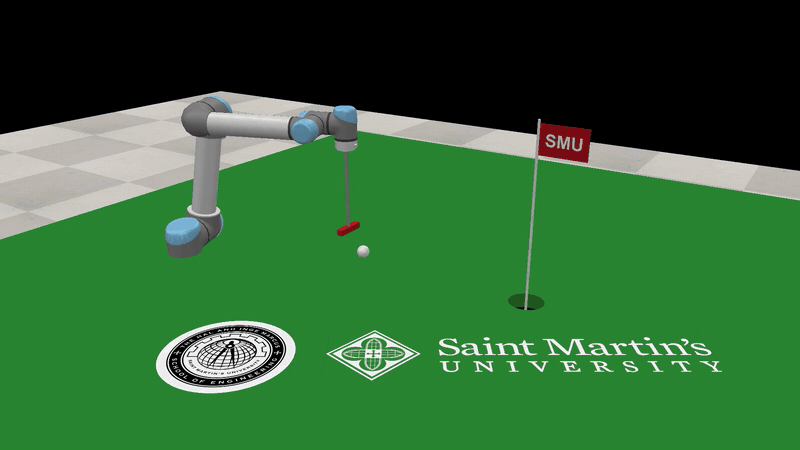
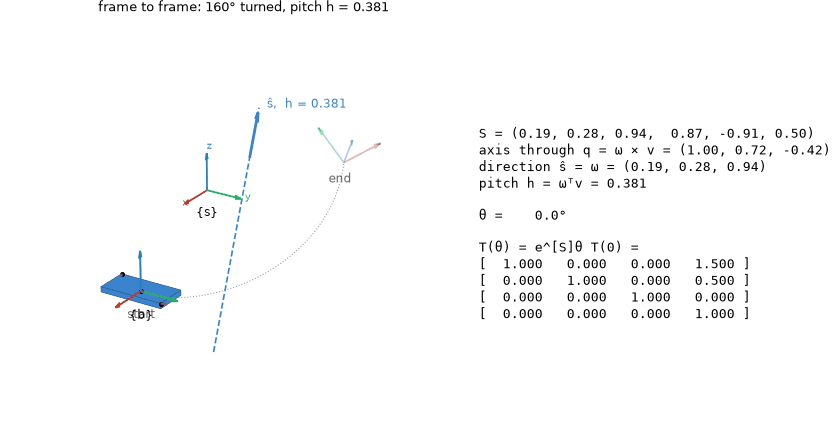
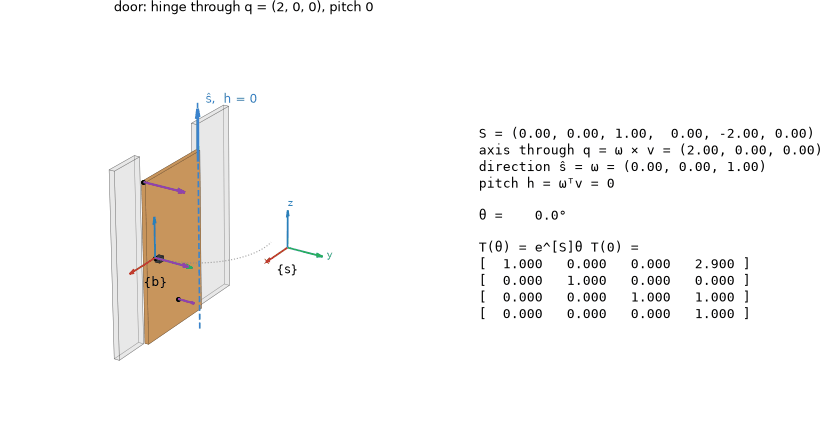
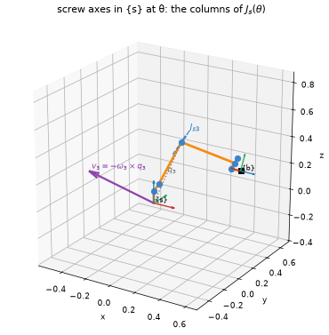
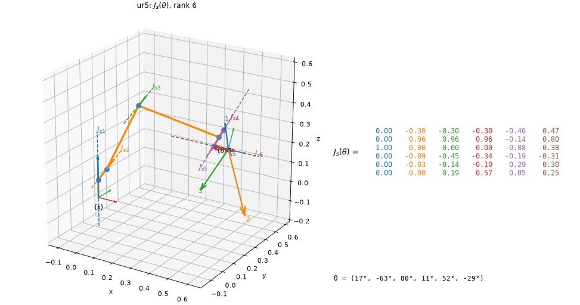
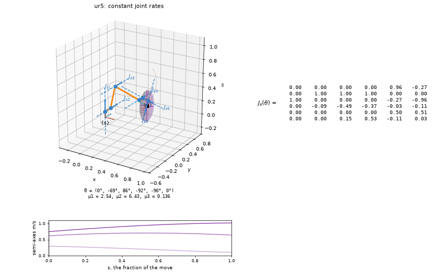
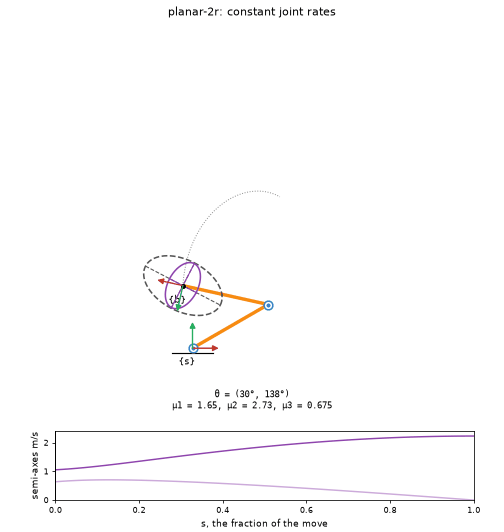
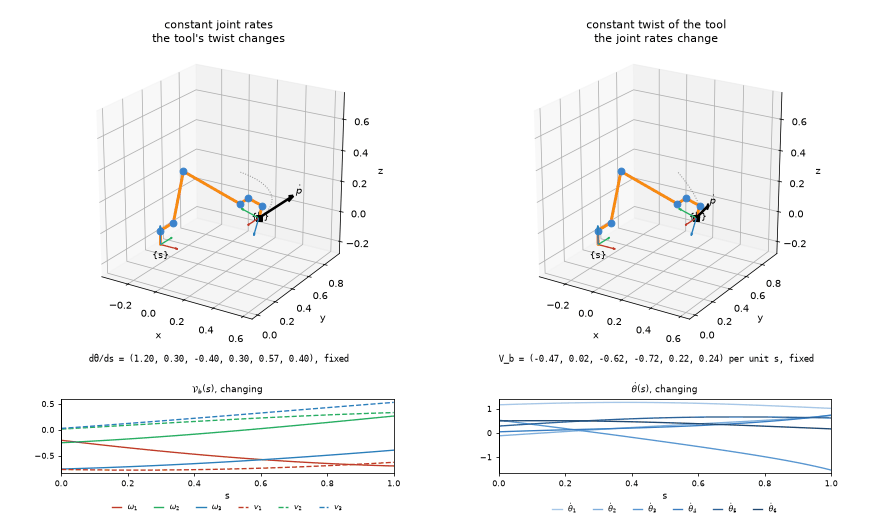

# Examples

Every picture here was drawn by `screws` itself, from the lines under it. The scripts in
[`examples/`](https://github.com/ricopicone/screws/tree/main/examples) make them all, and
each one's guide page says what to look for. The pictures need `screws[plot]`; in a notebook
each animation plays inline, and `.save("x.gif")` writes it out.

```python
import numpy as np
from screws import robots, se3, so3, viz

# the UR5, and the notes' planar 2R arm with L1 = L2 = 1
ur5, arm = robots.ur5(), robots.planar_2r()
```

## A UR5 sinks a putt



`screws.coppelia` drives CoppeliaSim. The example builds a green in a running simulator, with
a cup cut through the turf, a pin, a ball and a putter on the arm's flange. It then swings the
putter through the ball like a pendulum at a chosen speed and reports whether the ball
dropped. With `--video` it records itself.

```
uv run python examples/putt.py --video putt.mp4
```

More in [CoppeliaSim](guide/coppelia.md).

## One screw motion from a frame to another

{ loading=lazy }

Every rigid-body displacement is a screw motion (Chasles). `screw_between` finds the one that
carries `T_start` to `T_end`, and `animate_screw` plays it, with S, its axis and pitch, and
T(θ) beside it.

```python
w = np.array([0.2, 0.3, 1.0]) / np.linalg.norm([0.2, 0.3, 1.0])
T_start = se3.rp_to_transform(np.eye(3), [1.5, 0.5, 0.0])
R_end = so3.exp3(so3.vec_to_so3(np.deg2rad(160) * w))     # 160 degrees about w
T_end = se3.rp_to_transform(R_end, [1.0, 1.6, 0.9])
viz.animate_screw(viz.screw_between(T_start, T_end, name="frame to frame"))
```

More in [Watching a screw motion](guide/pictures/screw-motions.md).

## A door, a drawer and a screwdriver

{ loading=lazy }

The three pitches: zero (a hinge), infinite (a slide) and finite (a helix).

```python
viz.animate_screw(viz.door())
viz.animate_screw(viz.drawer())
viz.animate_screw(viz.screwdriver())
```

More in [Watching a screw motion](guide/pictures/screw-motions.md).

## The space twist and the body twist of one motion

![The door's motion drawn twice: on the left v_s at the origin of {s}, on the right v_b at the handle, with V_s = [Ad_Tsb] V_b underneath](media/door_frames.gif){ loading=lazy }

On the left is V_s, on the right V_b, and underneath them V_s = [Ad_Tsb(θ)] V_b, with the
adjoint changing as V_s stays fixed.

```python
viz.compare_frames(viz.door())
```

More in [Watching a screw motion](guide/pictures/screw-motions.md).

## Where a joint's screw axis is now

{ loading=lazy }

`axes="current"` draws each axis where the joints inboard of it have carried it, which is
column i of J_s(θ). `"construction"` builds that column, J_si = (ω_i, −ω_i × q_i).

```python
theta = [0.3, -1.1, 1.4, 0.2, 0.9, -0.5]
build = ("skeleton", "frames", "axes", "omega", "construction")
viz.draw_robot(ur5, theta, axes="current", joints=[2], show=build)
```

More in [Pictures of the screw axes](guide/pictures/screw-axes.md).

## The Jacobian's columns

{ loading=lazy }

The dashed lines are the six columns of J_s(θ). The numbered arrows show the velocity each
joint alone gives the tool point.

```python
viz.draw_jacobian(ur5, theta)
```

More in [Jacobians and ellipsoids](guide/pictures/jacobians.md).

## An ellipsoid that follows the arm

{ loading=lazy }

`animate_robot` moves the robot at constant joint rates. The axes, the manipulability
ellipsoid and the matrix follow it, and the chart underneath tracks the semi-axes. Here the
elbow straightens into a singularity, and J_s loses rank.

```python
theta0 = [0, -1.2, 1.5, -1.6, -1.57, 0]
viz.animate_robot(ur5, theta0, [0.4, -0.9, 0, -1.3, -1.57, 0.4], matrix=True)
```

More in [Jacobians and ellipsoids](guide/pictures/jacobians.md).

## Into a singularity

{ loading=lazy }

The 2R arm stretches out straight, and its velocity ellipse thins to a segment.

```python
start, end = [np.pi / 6, 2.4], [np.pi / 3, 0]   # theta2 = 0 is stretched out
viz.animate_robot(arm, start, end, force=True, planar=True)
```

More in [Jacobians and ellipsoids](guide/pictures/jacobians.md).

## Constant joint rates, or a constant twist

{ loading=lazy }

Both panels start and end in the same place. On the left the joint rates are constant and
the tool's twist changes. On the right the tool follows one screw motion, and inverse
kinematics finds the changing joint rates.

```python
viz.compare_paths(ur5, theta0, [1.2, -0.9, 1.1, -1.3, -1.0, 0.4])
```

More in [Jacobians and ellipsoids](guide/pictures/jacobians.md).

## The same computations as formulas

`screws.symbolic` does the computations in SymPy, so the forward kinematics and the
Jacobians come out in the joint variables:

```python
import sympy as sp
import screws.symbolic as sym

L1, L2 = sp.symbols("L1 L2", positive=True)
arm_sym = sym.SymbolicRobot.from_screw_axes(
    sym.trans([L1 + L2, 0, 0]),
    [sym.revolute_axis([0, 0, 0], [0, 0, 1]),    # joint 1 at the origin
     sym.revolute_axis([L1, 0, 0], [0, 0, 1])],  # joint 2 at (L1, 0, 0)
)
arm_sym.fk()[:3, 3]
```

```
Matrix([
[L1*cos(theta1) + L2*cos(theta1 + theta2)],
[L1*sin(theta1) + L2*sin(theta1 + theta2)],
[                                       0]])
```

```python
arm_sym.jacobian_body()
```

```
Matrix([
[                  0,  0],
[                  0,  0],
[                  1,  1],
[     L1*sin(theta2),  0],
[L1*cos(theta2) + L2, L2],
[                  0,  0]])
```

More in [Formulas](guide/formulas.md). To compare your own implementation of a function with
the library's, see [Check your own code](guide/checking.md); for joint sliders that redraw any
of these pictures in a notebook, see `viz.explore` in [Jacobians and ellipsoids](guide/pictures/jacobians.md).
