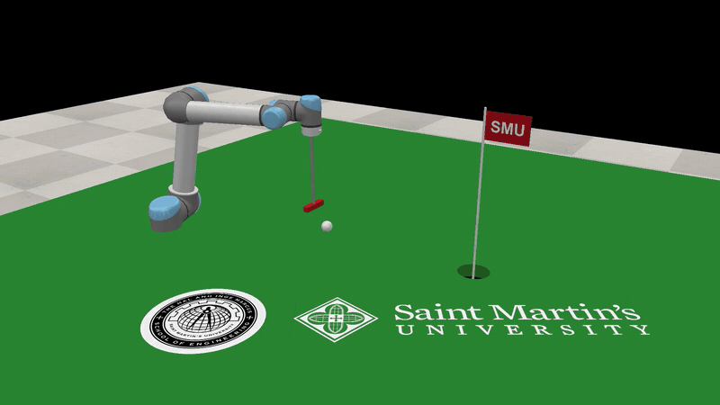

# CoppeliaSim

Works with CoppeliaSim 4.9 or later through the ZMQ remote API (0.1 verified on 4.10.0).

```python
from screws.coppelia import Scene

with Scene() as scene:                 # connects to localhost:23000 in stepping mode
    arm = scene.arm("/UR5")            # the joints under that tree, base to tip
    robot = arm.robot()                # a screws.Robot read off the scene at zero
    arm.mode("position")
    log = scene.run(lambda t, theta, dtheta: theta_desired(t), duration=5.0, arm=arm)
log.plot()                             # four stacked time plots: theta, dtheta, tau, command
log.to_csv("run.csv")
```

**Record a movie.** One frame per simulation step, so the movie plays at simulated time
however slowly the controller ran:

```python
with Scene() as scene:
    arm = scene.arm("/UR5")
    arm.mode("position")
    with scene.record_video("run.mp4", position=(1.5, -1.5, 1.0), look_at=(0, 0, 0.4)):
        scene.run(controller, duration=5.0, arm=arm)
```

`record_video` creates a camera (or reuses one: `camera="/Camera"`), grabs its image before
every step (`every=2` halves the frame rate), and on exit writes `.mp4` or `.gif`.

**In a notebook, release the clock between cells.** In stepping mode CoppeliaSim waits for
the next `step()`, and while it waits its window stops redrawing; after a few seconds it shows
a "ZMQ remote API server ... abort execution" banner, and clicking that kills the remote API
and strands the notebook. End a cell that stepped with `scene.release()`: the simulation then
runs on its own (position targets hold the arm still) and the window stays live. The next
`scene.step()` takes the clock back.

**Read the scene's masses.** `arm.robot(inertias=True)` reads every dynamic shape's mass and
inertia and builds the MR link frames and spatial inertias, so a model-based controller can
be run against the simulator's own numbers, and against the textbook's URDF numbers, and the
difference explained. `relative_to="base"` makes {s} the model's base frame.

`Scene` owns the connection and the clock (`start`, `step`, `release`, `stop`, `time`, `dt`,
`frame`, `show_frame`). `Scene.run` records every step into a `Log` (`t`, `theta`, `dtheta`,
`tau`, `command`, `T_sb` as arrays); `Log.plot()` draws one time-series axis per joint quantity
and shows the figure, `Log.to_csv` writes it out. `Arm` reads (`theta`, `dtheta`, `tau`, `tip_frame`) and commands
in one of three modes (`position`, `velocity`, `torque`), or `teleport`s without physics
to animate an IK history. `Arm.robot()` derives M and the screw axes from the scene's
joint frames (omega is the joint's z axis, v = -omega x q).

## An example: putting



[Full-resolution movie (mp4)](../media/putt.mp4), recorded by the example itself with `screws.coppelia.Recorder`.

`examples/putt.py` builds a green in a running CoppeliaSim (turf with a real cup cut through
it, a pin and flag, a ball, and a putter on the UR5's flange), drives the arm in kinematic
mode, addresses the ball, swings the putter through it like a pendulum at a chosen face
speed, returns to the address pose, and reports whether the ball dropped. It records the
putt at 1080p and, given PNGs, lays a seal and a logo on the green and texts the flag:

```
uv run python examples/putt.py --video putt.mp4 --flag-text SMU --seal seal.png --logo logo.png
```

The pieces are in `screws.coppelia.golf`: `build_green`, `attach_putter` (whose `.robot()`
moves `M` from the flange to the putter face), `address_pose`, `swing_path`, `putt`, and the
image helpers `text_image`, `seal_image` and `logo_image`. Vary the speed, the hole position
or the ball's friction and see what the physics does. Two lessons the example encodes: the
stock model's demo script is removed when the bridge takes the arm (it would fight you), and
a tool that must strike repeatably runs the arm in `arm.mode("kinematic")`.
