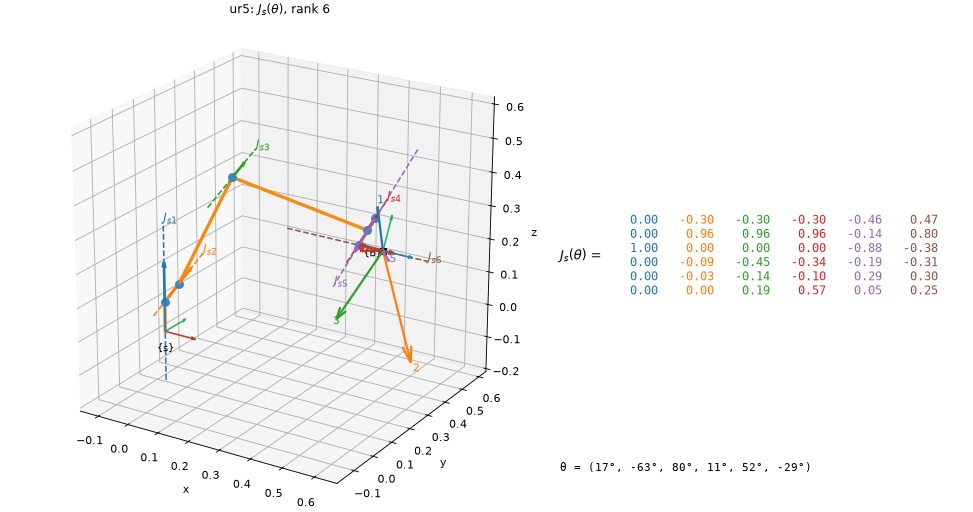
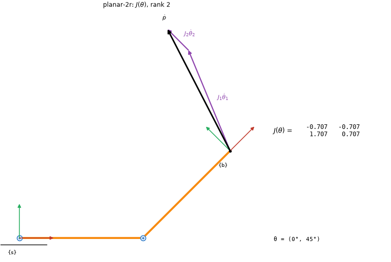
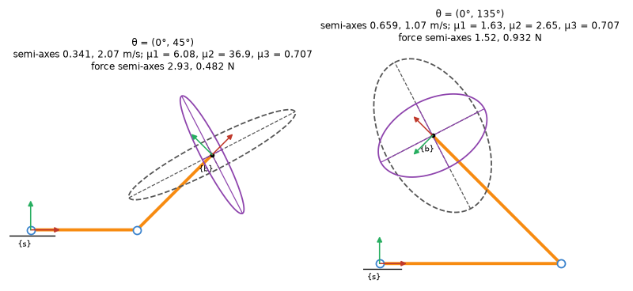
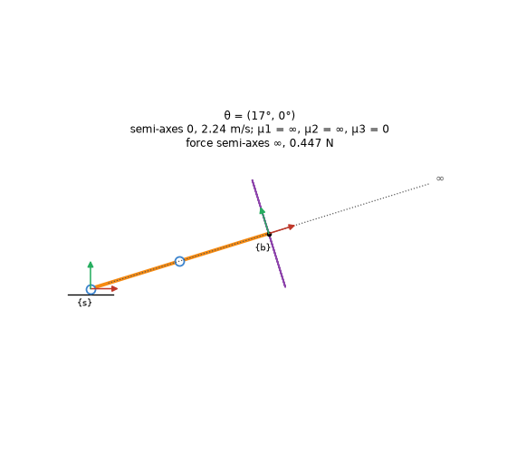
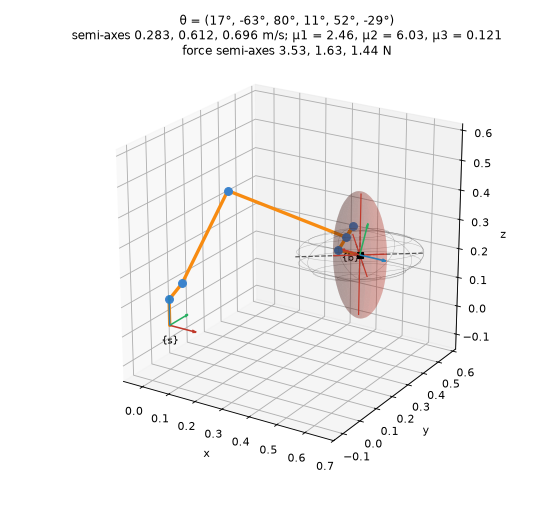
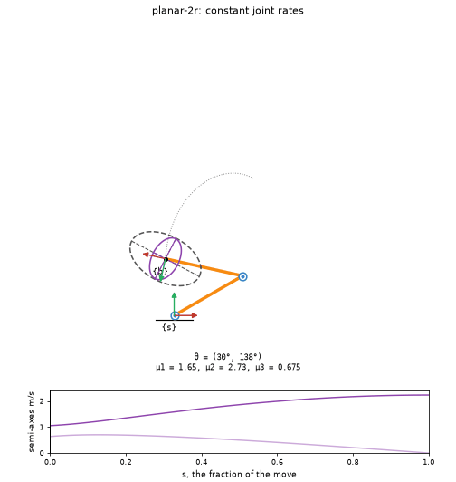
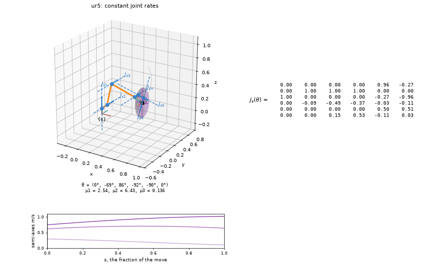
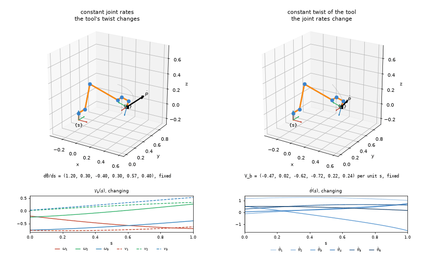

# Jacobians and manipulability ellipsoids

Every picture on this page was drawn by the package itself, from the call shown under it
(`examples/jacobians.py` writes them all). The robots are the UR5 and the notes' 2R arm, and
the numbers in the titles are the ones notes 5.5 works by hand.

```python
import numpy as np
from screws import robots, viz

ur5, arm = robots.ur5(), robots.planar_2r()        # planar_2r: the notes' 2R arm, L1 = L2 = 1
theta = [0.3, -1.1, 1.4, 0.2, 0.9, -0.5]
theta0 = [0, -1.2, 1.5, -1.6, -1.57, 0]
```

**Each column as what it is.** Column i of J_s(θ) is joint i's screw axis *now*, S_i carried
there by the joints inboard of it: the axis `draw_robot(ur5, theta, axes="current")` draws.
At home it is the S_i (J_s(0) = [S_1 ⋯ S_n]). The colours are the package's, set out with [the screw axes](screw-axes.md).



```python
viz.draw_jacobian(ur5, theta)
```

The dashed lines are the six columns of J_s, labelled J_s1 to J_s6. The numbered arrows at the
tool are the tool point's velocity, R_sb J_bv, per unit rate of each joint alone. The title
gives the rank and says when the configuration is singular. `frame="body"` redraws the same
lines from {b} and prints J_b.



```python
viz.draw_jacobian(arm, [0, np.pi / 4], dtheta=[1, 0.5], planar=True)
```

Every robot is drawn in 3D, a planar one included, unless `planar=True` asks for it flat, as
the notes draw the 2R arm. Its matrix is then the notes' 2 × 2 J(θ), here
[[−0.707, −0.707], [1.707, 0.707]]. Given θ̇ = (1, 0.5), the columns J_i θ̇_i go head to tail,
and their sum is ṗ.

**Manipulability and force, at the tool.** The purple ellipse is the image of the unit sphere
of joint rates: semi-axes √λ_i along the eigenvectors of A = JJᵀ. Dashed grey is the force
ellipsoid, on the same axes with semi-axes 1/√λ_i. μ1, μ2 and μ3 go in the title.



```python
viz.draw_ellipsoid(arm, [0, t2], force=True, planar=True, scale=0.3, force_scale=0.3, ax=ax)
```

The two postures of notes 5.5, drawn at one scale. Both have μ3 = 0.707, but μ1 is 6.08
against 1.63, which is the point that example makes. Left to itself, each ellipsoid gets its
own scale, its longest semi-axis 0.3 of the robot's reach.



```python
viz.draw_ellipsoid(arm, [0.3, 0], force=True, planar=True)
```

Stretched out, at θ2 = 0. The velocity ellipse is a segment, with semi-axes 0 and 2.24 m/s.
Along the arm the force ellipse is unbounded, so the picture draws only its bounded section,
dots the lost axis and marks it ∞. It never draws a big finite ellipse.



```python
viz.draw_ellipsoid(ur5, theta, force=True)
```

In 3D the linear ellipsoid comes from J_b's linear rows, as MR advises, turned into {s} so it
sits on the tool. The semi-axes are 0.283, 0.612 and 0.696 m/s, and μ1 = 2.46. The force
ellipsoid has its own scale.

**Through a change of configuration.** `animate_robot` moves the robot at a constant rate, and
the axes, the ellipsoid and (with `matrix=True`) the matrix follow it. The chart underneath
tracks the semi-axes, so a singularity shows up as one of them falling to zero.



```python
viz.animate_robot(arm, [np.pi / 6, 2.4], [np.pi / 3, 0], force=True, planar=True)
```

Constant joint rates into the stretched-out singularity. The short semi-axis reaches zero in
the last frame.



```python
viz.animate_robot(ur5, theta0, [0.4, -0.9, 0, -1.3, -1.57, 0.4], matrix=True)
```

The UR5 straightens its elbow, θ3 going to 0. By the end rank J_s = 5, but the tool point's
ellipsoid is still full, because the wrist can still move the tool point in every direction.
That is why the caption names the matrix that lost rank.

The default is constant joint rates, a straight line in joint space. `path="screw"` moves the
tool at a constant twist instead, the screw motion between the two tool frames, with the
joints following by inverse kinematics. Any (N, n) path plays as given: a `joint_trajectory`,
or an `IKResult.history` to watch Newton–Raphson converge. `.data` holds J_s, J_b, θ̇, V_s,
V_b and the semi-axes for every frame.

**Two kinds of constant rate.** Both panels start and end in the same place. Each charts the
quantity that changes along the way and states the one held fixed.



```python
viz.compare_paths(ur5, theta0, [1.2, -0.9, 1.1, -1.3, -1.0, 0.4])
```

On the left the joint rates are constant, so the tool's twist V_b changes and the tool does
not follow a screw. On the right the tool follows one screw motion at a constant twist, and
inverse kinematics finds the joint rates that change to make it happen. In the twist's chart
each component takes its axis's colour, ω solid and v dashed.

**The numbers behind the pictures.** The ellipsoids come from core `screws`, which needs no
matplotlib. These match the notes' chapter 5 UR5 ellipsoid program to every printed digit:

```python
>>> np.set_printoptions(precision=4)
>>> e = robots.ur5("textbook").manipulability_ellipsoid(np.full(6, np.pi / 2))
>>> e.eigenvalues            # λ of A = J Jᵀ, J = R_sb J_bv
array([0.0578, 0.1109, 0.2547])
>>> e.radii                  # √λ, m/s per unit joint rate
array([0.2404, 0.333 , 0.5046])
>>> np.round(e.measures, 4)  # μ1, μ2, μ3
array([2.0995, 4.408 , 0.0404])
>>> robots.ur5("textbook").force_ellipsoid(np.full(6, np.pi / 2)).radii
array([4.1604, 3.0027, 1.9816])
```

| Call | Gives |
| --- | --- |
| `screws.manipulability_ellipsoid(J)` | An `Ellipsoid` for any block of a Jacobian: `center`, `axes`, `eigenvalues`, `radii`, `measures`, `outline()`, `surface()` |
| `screws.force_ellipsoid(J)` | The same axes with reciprocal semi-axes, ∞ where J has lost rank |
| `robot.manipulability_ellipsoid(theta, kind)` | The tool's ellipsoid in {s}, `"linear"` (from J_b) or `"angular"` (from J_s); `planar=True` gives a planar arm's ellipse in the plane |
| `robot.force_ellipsoid(theta, kind)` | The same for forces (moments for `"angular"`) |
| `viz.explore(robot, draw=viz.draw_ellipsoid)` | Joint sliders in a notebook that redraw `draw_robot`, `draw_jacobian` or `draw_ellipsoid` |
