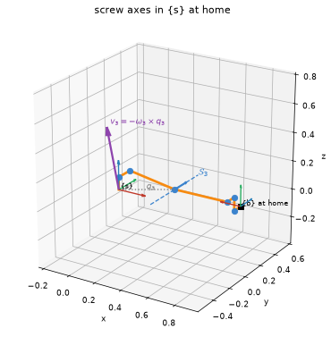
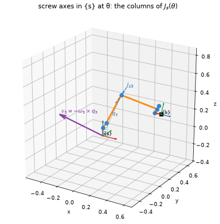

# Pictures of the screw axes

```python
import screws
from screws import viz

ur5 = screws.robots.ur5()
theta = [0.3, -1.1, 1.4, 0.2, 0.9, -0.5]
viz.draw_robot(ur5)                                   # skeleton, {s}, and S_1 ... S_6 at home
viz.draw_robot(ur5, frame="body")                     # the same robot seen from {b}: B_1 ... B_6
viz.draw_robot(ur5, theta, axes="current")            # the axes where theta has carried them: J_s(theta)
viz.draw_robot(ur5, joints=[2], show=("skeleton", "frames", "axes", "omega", "construction"))
viz.draw_screw(screws.screw_axis(q=[0.3, 0, 0], s_hat=[0, 0, 1], h=0.05))   # one axis by itself
viz.explore(ur5)                                      # joint sliders, in a notebook
```



`draw_robot` draws the robot's skeleton at `theta` (default: home), the reference frame,
and one screw axis per joint through the joint's home position with its ω̂ arrow. With
`"construction"` it also draws, for each chosen joint, the point q on the axis, the cross
product −ω̂×q, the pitch term hω̂, and their sum v at the origin, so the formula
v = −ω̂×q + hω̂ is something you can look at. The body-frame view redraws everything in {b},
which is why the B_i differ from the S_i. Every drawing returns the vectors it drew, so a
figure can be checked by hand. Needs `screws[plot]`.

**Where the axes are now.** The default, `axes="home"`, draws the axes at home even when the
arm is posed at θ: they are the S_i of the product of exponentials. `axes="current"` draws
each axis where the joints inboard of it have carried it, which is column i of J_s(θ) (of
J_b(θ) with `frame="body"`), labelled J_si. With `"construction"` the same drawing builds that
column, J_si = (ω_i, −ω_i × q_i) for a revolute joint through q_i, as MR 5.1.1 builds J_s:



```python
viz.draw_robot(ur5, theta, axes="current", joints=[2], show=("skeleton", "frames", "axes", "omega", "construction"))
```

`viz.draw_jacobian` is this drawing with the velocities the joints give the tool, and the
matrix beside it; see [Jacobians and manipulability ellipsoids](jacobians.md).

**Colours.** Every picture the package draws uses one colour per meaning, never one per
joint. Red, green and blue are a frame's x̂, ŷ and ẑ and nothing else. Links are orange and
joints blue, as in the notes, and a screw axis, with its ω̂, is the joints' blue. Purple is
velocity: v (its pieces −ω̂×q and hω̂ a lighter purple), the velocities of points in a screw
motion, the velocities the joints give the tool, and the manipulability ellipsoid that collects
them. Grey is a position or a path, and the force ellipsoid is grey and dashed. Labels tell
the joints apart.
