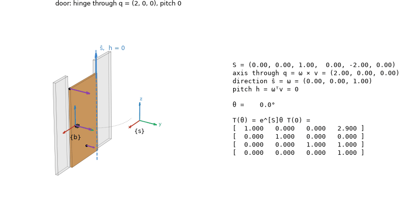
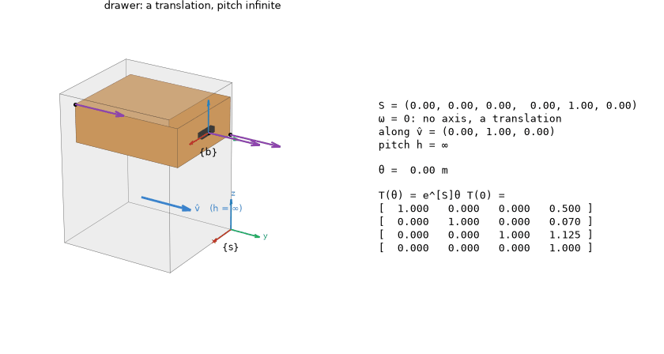
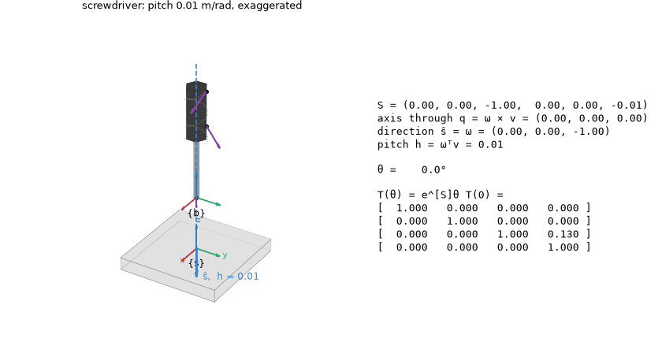
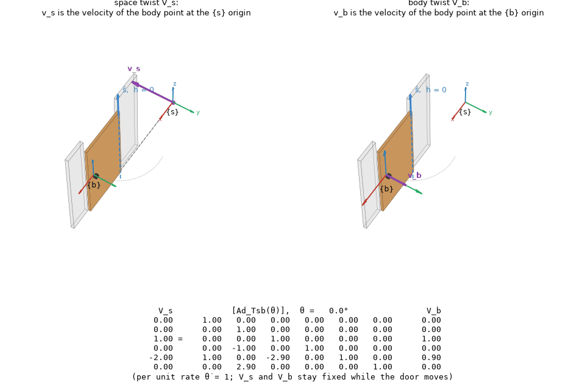
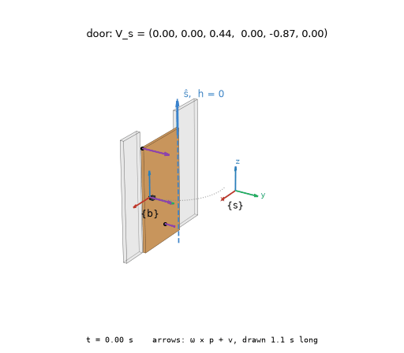
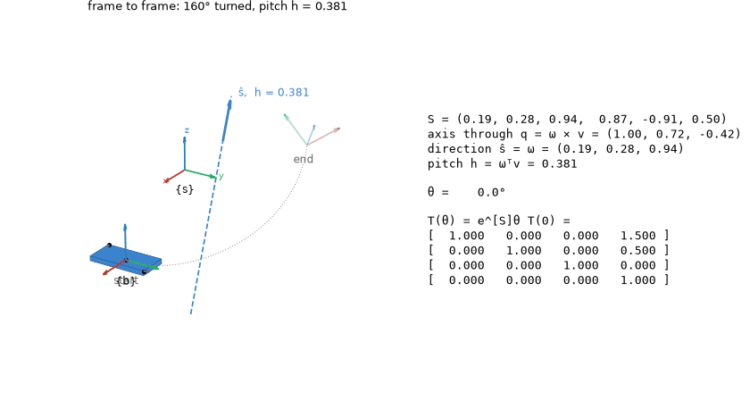

# Watching a screw motion

```python
from screws import viz

viz.animate_screw(viz.door())          # the door swung about its hinge, with T(θ) = e^[S]θ T(0) beside it
viz.animate_twist(viz.screwdriver())   # the screwdriver under a constant twist: a helix about -z
viz.compare_frames(viz.door())         # V_s beside V_b, and V_s = [Ad_Tsb] V_b underneath
viz.animate_screw(viz.screw_between(T_start, T_end))   # the one screw motion from one frame to another
viz.animate_twist([0, 0, 1, 0, -0.5, 0.1], duration=4).save("mine.gif")   # any twist, any body
```

A twist is a motion before it is a six-vector. `animate_twist` plays a constant twist on a
body: the screw axis drawn as a line with ŝ and the pitch h, one point's path traced (a
helix, or a circle at zero pitch), and purple arrows for the velocities ω × p + v of a few
points. `animate_screw` sweeps a screw axis over θ and prints the line read off it,
q = ω × v and h = ωᵀv, with T(θ) changing alongside.

**Three pitches.** The scenes `viz.door()`, `viz.drawer()` and `viz.screwdriver()` are the
three motions of the notes' chapter 3 review: zero, infinite and finite pitch.







**Space and body twists.** `compare_frames` draws one motion twice. On the left, v_s is the
velocity of the body point at the {s} origin: the grey marker is the point that was there
at θ = 0, carried off by the motion while the point now at the origin keeps the same
velocity. On the right, v_b is the velocity of the point at {b}. Under them,
V_s = [Ad_Tsb(θ)] V_b, the adjoint changing and V_s fixed.



`animate_twist` plays the same door in time, V_s = S θ̇:



**From one frame to another.** Every rigid-body displacement is a screw motion (Chasles).
`viz.screw_between(T_start, T_end)` finds the one that carries `T_start` to `T_end`, from
[S]θ = log(T_end T_start⁻¹) with S a unit screw axis, and `animate_screw` shows the frame
travelling along it, its origin tracing the helix, the start and end frames faded:



Each call returns an `Animation`: `.save("x.gif")` (or `.mp4` with `screws[video]`), it plays
inline in a notebook, and `.data` holds the numbers drawn. `viz.Scene`, `viz.box` and
`viz.prism` build your own body. The geometry is `screws.screw_line`, `screw_motion`,
`point_velocity` and `helix`, numpy only. `examples/screw_motions.py` writes every GIF here.
