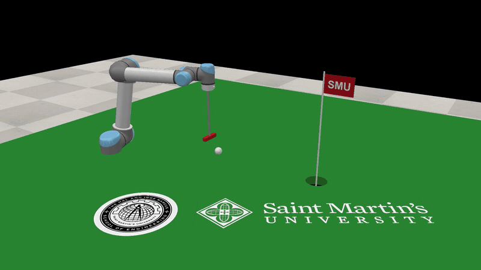

# screws

[](https://doi.org/10.5281/zenodo.23873253)

Robotics in Python, built on screw theory: every rigid-body motion is a screw motion, the
exponential of a twist, and an open chain is a product of such exponentials. Kinematics,
Jacobians and dynamics all follow from that. The notation is that of Lynch and Park,
*Modern Robotics* (MR).

- **The mathematics.** Rotations and rigid-body motions with their exponentials and
  logarithms; twists, wrenches and adjoints; forward and inverse kinematics; space and body
  Jacobians; manipulability and force ellipsoids; Newton-Euler dynamics; trajectories.
- **Robots.** A `Robot` class that carries M, the screw axes and the link inertias, a URDF
  loader, and three robots ready to use: a UR5, an RRP arm and a planar 2R arm.
- **Formulas.** `screws.symbolic` does the same computations in SymPy, so the product of
  exponentials, the Jacobians and the equations of motion come out in the joint variables.
- **Pictures.** `screws.viz` draws a robot with its screw axes, animates screw motions, and
  shows Jacobians and manipulability ellipsoids, still or while the robot moves, with joint
  sliders in a notebook.
- **Simulation.** `screws.coppelia` drives CoppeliaSim: read a robot off a scene, command it
  by position, velocity or torque, log and plot the run, and record a movie.
- **Checks.** `screws.testing` compares your own implementation of a function with the
  library's.

[](examples.md)

A UR5 sinks a putt in CoppeliaSim, driven through `screws.coppelia`. The package's own
pictures, of screw axes, screw motions, Jacobians and manipulability ellipsoids, are on the
**[Examples](examples.md)** page, each with the lines that draw it.

`screws` started from the MR code library, and all of that library is still here: each
function under a snake_case name, with MR's name kept as an alias
(`screws.FKinSpace is screws.fk_space`). The tests run every example in MR's docstrings
through those aliases.

## Four lines

```python
import screws

ur5 = screws.robots.ur5()                          # M, screw axes, inertias from the textbook's URDF
T = ur5.fk([0.3, -1.2, 0.8, -0.4, 1.1, 0.2])         # a reachable, non-singular pose
result = ur5.ik(T, theta0=[0.1, -1.4, 0.1, 0.1, 1.4, 0.1])   # result.theta, result.converged, result.history
```

## Where to go next

- **[Examples](examples.md)**: what the package draws, with the code under each picture.
- [Install](install.md) the package, with the extras for pictures, the simulator and movies.
- [Kinematics and the Robot class](guide/kinematics.md), [dynamics and trajectories](guide/dynamics.md),
  and [checking your own code](guide/checking.md) against the library.
- [Formulas](guide/formulas.md): the same computations in SymPy.
- Pictures: [the screw axes](guide/pictures/screw-axes.md),
  [screw motions](guide/pictures/screw-motions.md), and
  [Jacobians and manipulability ellipsoids](guide/pictures/jacobians.md).
- [CoppeliaSim](guide/coppelia.md): driving the simulator, and a UR5 that putts.
- [MR's names](guide/names.md) beside the `screws` names, and the [API reference](reference/so3.md).

## Citing

Use [CITATION.cff](https://github.com/ricopicone/screws/blob/main/CITATION.cff), or GitHub's
"Cite this repository" button, which reads it. Zenodo archives every release: the DOI
[10.5281/zenodo.23873253](https://doi.org/10.5281/zenodo.23873253) stands for `screws` as a whole and leads to the
latest version, and each version has a DOI of its own on that page.
